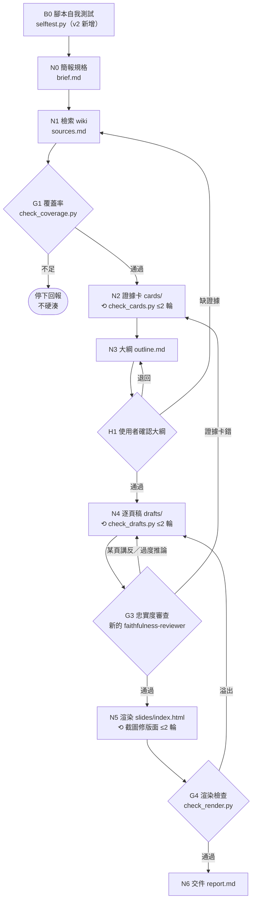

# AI 時代的程式學習：LLM Wiki ＋ 教學簡報

生成式 AI 第 10 週作業「把你的工作拆成 AI 能做的流程」。

## 1. LLM Wiki 主題與簡介

**主題：AI 時代，程式該學到什麼程度？該怎麼學？**

依 Karpathy 的 [LLM Wiki](llm-wiki.md) 構想，把 6 篇研究整理成一個由 LLM 維護的知識庫：

- **三層架構**：`raw/`（原始論文，只讀）→ `wiki/`（LLM 寫的 15 頁）→ [`AGENTS.md`](AGENTS.md)（規則書，`CLAUDE.md` 只有一行 `@AGENTS.md`）
- **先討論、後生成**：建立前先做 9 題訪談，確定讀者、頁面類型、出處粒度、矛盾處理等，見 [`process/interview.md`](process/interview.md)
- **頁面**：6 個來源摘要頁、4 個概念頁（含名詞解釋）、2 個比較頁（處理研究之間看似矛盾的結論）、2 個主題頁（對應簡報段落）、1 個總覽
- **出處**：每段都標 `(S2, p.5)`，頁碼是 PDF 頁序；英文引文由腳本逐字比對原文
- **操作**：一次 ingest 一篇（S1→S6），每篇都跑 [`scripts/lint_wiki.py`](scripts/lint_wiki.py)（9 項檢查）；全部完成後再由新的 subagent 做一次語意審查

🔗 **Wiki**：https://github.com/ash-eeee/ai-coding-wiki/tree/main/wiki （從 [`wiki/index.md`](wiki/index.md) 或 [`wiki/overview.md`](wiki/overview.md) 開始）

## 2. 教學 HTML 簡報

🔗 **簡報**：https://ash-eeee.github.io/ai-coding-wiki/slides/ （← → 翻頁）

13 頁，16:9，對象是看得懂程式、但還不會自己應用的大學生。每頁左邊是重點、右邊是圖表或圖示（長條圖、範圍圖、人數圖、流程圖等，數字都來自證據卡），底部標 wiki 頁名與原始資料頁碼。

| 段落 | 頁 | 要回答的問題 |
|---|---|---|
| 封面 | 1 | AI 都會寫程式了，我們還要學嗎？ |
| ① 為什麼還要學 | 2 | 學程式還有意義嗎？（S4） |
| ② AI 真的讓人變快嗎 | 3 | 感覺變快＝實際變快？（S1） |
| ③ 用 AI 學得會嗎 | 4 | 學得更好還是更差？（S2、S3） |
| ④ 差別在怎麼用 | 5–6 | 哪些用法有學到？（S2、S6） |
| ⑤ 學校怎麼教 | 7 | AI 當助教、不當槍手（S5） |
| ⑥ 該學到哪、怎麼學 | 8–12 | 必備能力、學習階段、練習方法、用 AI 守則、自我檢查清單 |
| 總結 | 13 | AI 能幫你，但「會」要自己練 |

## 3. Loop / Graph 設計

設計原則：**Graph 為主、Loop 為輔**。Graph 決定大流程，每個節點內部是有次數上限的小 loop。完整規格：[`.claude/skills/topic-slides/SKILL.md`](.claude/skills/topic-slides/SKILL.md)（輸入 `/topic-slides` 觸發）。

**哪些步驟會重複執行（小 loop）**
- N2：寫卡 → `check_cards.py`（引文逐字比對原文、數字要在原文該頁）→ 修，最多 2 輪
- N4：寫稿 → `check_drafts.py`（逐點標卡片、數字、條件詞、絕對化用語、字數）→ 修，最多 2 輪
- N5：渲染 → 截圖 → 修版面，最多 2 輪

**哪些地方需要檢查或重新生成**
- G1：wiki 資料不夠 → 停下，不用模型自身知識補
- H1：使用者看大綱，退回 N3 或回 N1 補檢索
- G3：AI 審查**只退回出問題的那一頁**到 N4；證據卡本身錯就退回 N2
- G4：溢出 → 退回 N4 縮短文字（不准縮小字體）
- 全域剎車：同一關卡累計退回 3 次 → 停下交給使用者

**為什麼這樣設計**
- **錯誤在離源頭最近的地方抓到**：引文和數字在 N2 就逐字比對原文，不等到簡報做好才發現
- **每關權限分開**：N4 只能看大綱指定的卡片、N5 不能改任何字（由腳本逐字轉換），出錯時很容易定位是哪一關
- **AI 審查用新的 subagent**：審查者只拿到成品與來源，看不到製作過程，避免「審自己的作品」
- **狀態都是檔案、每關都 commit**：任何一關都能從檔案重跑，git log 就是執行紀錄
- **剎車**：小 loop 與全域退回都有上限，避免無限迴圈

## 4. 一次實際執行的結果

完整紀錄：[`topic/ai-era-coding/report.md`](topic/ai-era-coding/report.md)；各關原始輸出在 [`topic/ai-era-coding/review/`](topic/ai-era-coding/review/)（含 13 張 G4 截圖）；每一步都有 `[節點代號]` commit。

| 節點／關卡 | 次數 | 結果 |
|---|---|---|
| G1 覆蓋率 | 1 | 通過 |
| N2 證據卡 40 張 | 2 | 第 1 輪失敗 1 項（腳本 bug）→ 通過 |
| N4 逐頁稿 13 頁 | 4 | 第 1、2 輪失敗（1 項稿子錯、2 項腳本誤判）→ 第 3 輪通過，**超過小 loop 上限 1 輪** |
| G3 忠實度審查 | 2 | round-1：10/13 PASS，退回 3 頁到 N4（遺漏條件 ×2、過度推論 ×1）→ round-2：13/13 PASS |
| G4 渲染檢查 | 1 | 通過 |

**第二次執行（workflow v2）**：依反思修改流程後重跑受影響節點。B0 selftest 通過；G3 round-3 退回 2 頁＋1 張卡（其中一個錯誤是我在第一次修正時引入、又被 v2 的 `keep` 鎖住）；round-4 13/13 PASS；G4 通過。v1／v2 比較見 `report.md` 第 7 節。

**使用者回饋（v2.1）**：使用者看成品後指出「比例接近正方形」「不該只有文字」，兩者都是所有關卡都沒抓到的問題。修正版面、每頁加入圖表或圖示，並讓 G4 在 6 種視窗尺寸下檢查 16:9、檢查圖表文字是否被裁切；G3 round-5 審查視覺忠實度 13/13 PASS。見 `report.md` 第 8 節。

Wiki 階段：6 次 ingest 中有 2 次 lint 第 1 輪失敗（都是規則或腳本誤判）。A6 由新 subagent 做語意審查，抓到 20 個腳本抓不到的問題（高 2、中 8、低 10），全部修正，見 [`process/a6-wiki-review.md`](process/a6-wiki-review.md)。

## 5. 反思

> 根據 `report.md` 的實際紀錄撰寫。修改細節見 [`process/workflow-changes.md`](process/workflow-changes.md)。

**哪個節點最常出錯？** N4 逐頁稿。真正的內容錯誤全部發生在「把證據卡濃縮成一句短重點」這一步：丟掉研究對象（10–17 歲新手 vs 有經驗的工程師）、丟掉「未實測」這類保留語氣，或把「看起來是重要能力」寫成「才用得好」。這些錯腳本一個都沒抓到，全靠 G3 的 AI 審查。Wiki 階段也一樣：lint 全過，AI 審查還是抓到 20 個語意問題，兩個「高」都出在摘要句。

**錯誤的根源在哪？檢查往前移到哪？**
- 根源其實在 **N2**：v1 的卡片只有一句 claim，沒有記錄適用條件，N4 一濃縮就丟了。v2 讓卡片必填 `scope`，並用 `keep` 標出投影片上一定要留的條件詞，**把 G3 的檢查往前移到 N2 寫卡與 N4 腳本**。
- 「才用」這類絕對化用語、「總結頁不得有新論點」原本只靠 AI 判斷，v2 改成 `check_drafts.py` 直接檢查。
- 另一個意外：腳本抓到的 6 項失敗中，有 3 項是**檢查腳本自己的 bug**（連字號、CS50 被當數字）。這讓 N4 小 loop 超過上限。v2 在 B0 加 `selftest.py`，**把腳本錯誤往前移到開始跑之前**。
- 回溯測試：v2 腳本能在 G3 之前標出 round-1 退回的 3 頁。但 slide-10 的主要問題（排序題的使用時機）沒有直接抓到，而且 `keep` 是看過失敗後才寫的，結果偏樂觀。

**v2 跑完的新發現**：`keep` 能把條件鎖在稿子上，但 keep 寫錯時腳本反而會強制保留錯字（C12 就是這樣）；另外不同 G3 審查實例的嚴格程度不一致。所以「把檢查往前移」不代表後面的 AI 審查可以拿掉，前面加的規則本身也要被審查。

**交件後使用者發現的問題**：簡報在窄視窗會被壓成接近正方形、而且只有文字。G4 只在剛好 1280×720 測試，規格也沒要求視覺，所以全部關卡都通過。腳本與 AI 審查只能檢查「規格寫到的東西」，沒寫進規格的期待只有人看成品才會發現，所以 N5 之後應該要有人看成品的關卡。

**學到的事**：腳本適合檢查「字有沒有對」，AI 審查適合檢查「意思有沒有變」。要讓 AI 審查少退件，關鍵不是寫更聰明的腳本，而是在上游就把「哪些條件不能丟」寫成資料。

## 6. 原始資料

6 篇論文清單、作者、連結：[`raw/sources.md`](raw/sources.md)。PDF 與轉出的純文字有版權，不放上 GitHub。

| 代號 | 資料 |
|---|---|
| S1 | Becker et al. (2025) METR：AI 對資深開源開發者生產力的影響 |
| S2 | Shen & Tamkin (2026) Anthropic：How AI Impacts Skill Formation |
| S3 | Kazemitabaar et al. (2023) CHI：AI 程式產生器與初學者學習 |
| S4 | Brynjolfsson, Chandar & Chen：Canaries in the Coal Mine（2026 年 8 月修訂版） |
| S5 | Liu et al. (2024) SIGCSE：Teaching CS50 with AI |
| S6 | Prather et al. (2024) ICER：The Widening Gap |

## 檔案導覽

| 作業要求 | 位置 |
|---|---|
| 先討論、後生成 | [`process/interview.md`](process/interview.md) |
| Wiki 規則書 | [`AGENTS.md`](AGENTS.md) |
| Wiki 成果（6 篇 ingest） | [`wiki/`](wiki/)、[`wiki/log.md`](wiki/log.md) |
| 流程規格 | [`.claude/skills/topic-slides/SKILL.md`](.claude/skills/topic-slides/SKILL.md)、[`.claude/agents/faithfulness-reviewer.md`](.claude/agents/faithfulness-reviewer.md) |
| 檢查腳本 | [`scripts/`](scripts/) |
| 執行紀錄 | [`topic/ai-era-coding/report.md`](topic/ai-era-coding/report.md)、[`review/`](topic/ai-era-coding/review/)、git log |
| 反思與 workflow 修正 | 本頁第 5 節、[`process/workflow-changes.md`](process/workflow-changes.md) |
